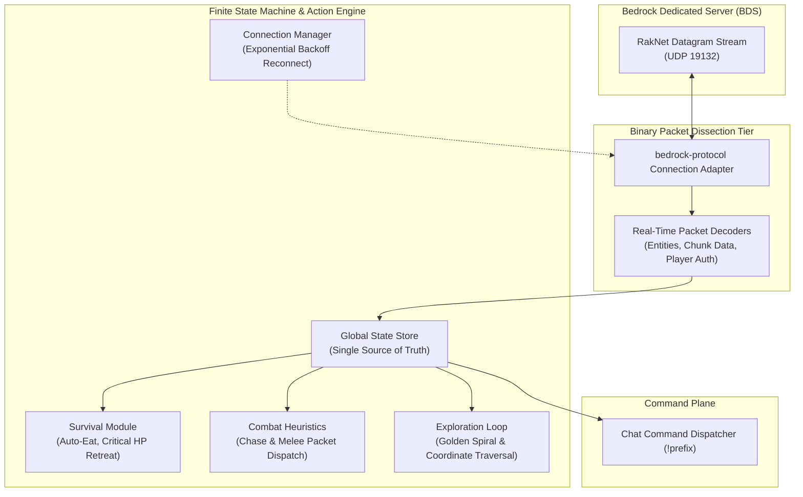

<div align="right">
  <strong>English</strong> | <a href="README.pt-BR.md">Português</a>
</div>

# Bedrock Autonomous Agent ⚡📦

[](https://nodejs.org/)
[-red.svg)](https://github.com/PrismarineJS/bedrock-protocol)
[](https://www.minecraft.net/en-us/download/server/bedrock)
[]()
[](LICENSE)

> **Low-Level Native Bedrock Dedicated Server (BDS) UDP Protocol Agent & Finite State Machine.**  
> An experimental research engine interfacing directly with Minecraft Bedrock's binary packet stream (`RakNet` / `bedrock-protocol`) for autonomous state tracking, reconnection backoff, and chat-driven dispatch.

---

## 📌 Protocol Architecture & Packet Flow

Unlike Java Edition's TCP stream, Bedrock Edition operates over raw UDP/RakNet datagrams. The agent communicates directly with the binary wire protocol.



---

## 🔬 Experimental Research & Status

> [!NOTE]
> **Active Research Phase:** This project explores reverse-engineered Bedrock client kinematics, entity synchronization, and non-blocking UDP packet handlers.

### Key Capabilities Implemented
- **Binary Handshake & Version Negotiation:** Dynamically negotiates version payloads across BDS `1.26.x` minor releases.
- **Resilient Reconnection Loop:** Exponential backoff strategy preventing IP ban rates on unexpected network drops.
- **Low-Overhead Packet Actions:** Dispatches native attack, look, and inventory transactions without high-level abstraction bloat.
- **Autonomous Subroutines:** Golden spiral search pattern for mob engagement and autonomous food consumption.

---

## 🛠️ Execution

```bash
# 1. Clone repository
git clone https://github.com/welzim19-star/bedrock-autonomous-agent.git
cd bedrock-autonomous-agent

# 2. Install dependencies
npm install

# 3. Launch agent
node index.js
```

---

## ⚖️ License
Distributed under the **MIT License**.
