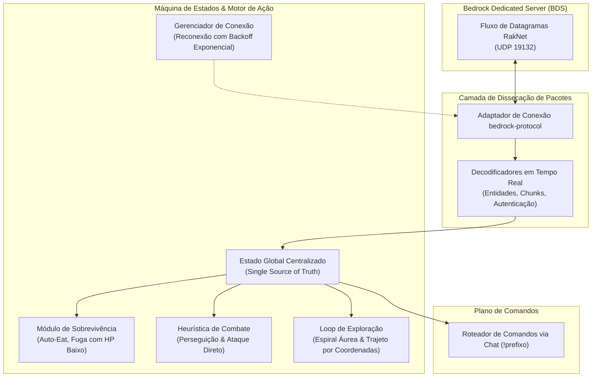

<div align="right">
  <a href="README.md">English</a> | <strong>Português</strong>
</div>

# Bedrock Autonomous Agent ⚡📦

[](https://nodejs.org/)
[-red.svg)](https://github.com/PrismarineJS/bedrock-protocol)
[](https://www.minecraft.net/en-us/download/server/bedrock)
[]()
[](LICENSE)

> **Agente de Baixo Nível para Protocolo UDP Nativo do Bedrock Dedicated Server (BDS) & Máquina de Estados.**  
> Motor de pesquisa experimental que se comunica diretamente com o fluxo binário de pacotes do Minecraft Bedrock (`RakNet` / `bedrock-protocol`) para rastreamento autônomo de estado, reconexão com backoff e despacho via comandos de chat.

---

## 📌 Arquitetura de Protocolo & Fluxo de Pacotes

Diferente da Java Edition que utiliza TCP sequencial, a Bedrock Edition opera sobre datagramas UDP brutos via RakNet. O agente se comunica diretamente com essa camada binária.



---

## 🔬 Pesquisa Experimental & Status

> [!NOTE]
> **Fase Ativa de P&D:** Este projeto explora a cinemática do cliente Bedrock por engenharia reversa, sincronização de entidades e handlers UDP não bloqueantes.

### Recursos Implementados
- **Handshake Binário e Negociação de Versão:** Negocia dinamicamente as versões suportadas entre revisões do BDS `1.26.x`.
- **Loop Resiliente de Reconexão:** Algoritmo de backoff exponencial prevenindo bloqueios por flood de conexões.
- **Ações Primitivas de Pacote:** Emissão direta de transações de inventário, rotação de câmera e pacotes de ataque sem intermediários pesados.
- **Sub-rotinas Autônomas:** Padrão de busca em espiral áurea para rastreamento de entidades e alimentação automática.

---

## 🛠️ Execução

```bash
# 1. Clonar o repositório
git clone https://github.com/welzim19-star/bedrock-autonomous-agent.git
cd bedrock-autonomous-agent

# 2. Instalar dependências
npm install

# 3. Iniciar o agente
node index.js
```

---

## ⚖️ Licença
Distribuído sob a **Licença MIT**.
